# VDPVIEW — VDP 目視確認テスト

VDPVIEW.COM は、自動判定ができない（画面を見て確認する）VDP の表示をまとめて確認する MSX-DOS 用プログラムです。
本物の V9958 と同じ見え方になるかを、少ない確認箇所で判定できるように作っています。

## 使い方

```
A>VDPVIEW
```

| キー | 動作 |
|---|---|
| SPACE / RETURN / → | 次のページ |
| BS / ← | 前のページ |
| ESC | 終了（画面をテキストに戻して DOS へ） |

- 最後のページで次へ進むと終了します。
- V9938 では起動しません。V9958 では V9968 専用ページ（タイトルが V9968 で始まるもの）を飛ばします。
- turboR では Z80 モードに切り替えて実行し、終了時に元の CPU モードに戻します。

## 判定の基本

- **赤が見えたら NG**: 端の表示のページでは、スプライトが乗るはずの位置に赤い下絵を描いています。スプライトが正しい位置・形で表示されれば、赤は完全に隠れます。
- **スプライト = 見本**: 色のページでは、スプライトのすぐ下（または画面端）に、期待される色の見本を背景で描いています。
- 走査線割込み・ポーリングのページは、切り替え位置が 1〜2 ライン遅れたり行の途中になったりするのは正常です。切り替わるラインがフレームごとに揺れないことを確認します（ポーリングのページの横位置の揺れは正常）。

## 参照画像について

- P01〜P13 は openMSX（Panasonic FS-A1GT、V9958）のスクリーンショットです。実機 V9958（FS-A1GT）でも同じ見え方になることを確認済みで、そのキャプチャも並べています。
- P17 は後から追加したページで、openMSX（Panasonic FS-A1GT、V9958）のスクリーンショットです。
- P14〜P16（V9968 専用）は、openMSX（Panasonic_FS-A1ST_V9968）のスクリーンショットと、生成器 gen_vdpview.py のモデルから描いた期待画像（V9968 マニュアルと RTL に基づく）の両方を載せています。判定には期待画像を使います。
- openMSX の Panasonic_FS-A1ST_V9968 は Port#4 の読み出しで FFh を返すため、VDPVIEW は V9968 と判定しません。スクリーンショットは、撮影用スクリプトでメモリ上の判定結果を V9968 に書き換えて撮りました。
- openMSX の V9968 実装は正解の基準にしません。openMSX と見え方が違っても、それを理由に FPGA を修正しないでください。

## ページ一覧

| No. | タイトル | 内容 |
|---|---|---|
| P01 | SC2 SPRITE M1 8X8 | SCREEN 2 / スプライトモード1 / 8x8 等倍 |
| P02 | SC2 SPRITE M1 16X16 X2 | SCREEN 2 / スプライトモード1 / 16x16 拡大 |
| P03 | SC5 SPRITE M2 16X16 | SCREEN 5 / スプライトモード2 / 16x16 等倍 / 212ライン |
| P04 | SC6 SPRITE M2 16X16 X2 | SCREEN 6 / スプライトモード2 / 16x16 拡大 / 212ライン |
| P05 | SC7 SPRITE M2 8X8 192L | SCREEN 7 / スプライトモード2 / 8x8 等倍 / 192ライン |
| P06 | SC8 SPRITE M2 8X8 X2 | SCREEN 8 / スプライトモード2 / 8x8 拡大 / 212ライン |
| P07 | SC5 SPRITE COLOR | SCREEN 5 のスプライト色（色0〜15、TP=0/1、CC 合成、優先順位、9枚目非表示） |
| P08 | SC6 BORDER + SPRITE | SCREEN 6 の周辺色（R#7 の値0〜15を12ラインごとに変更）とスプライト色 |
| P09 | SC8 BORDER + SPRITE | SCREEN 8 の周辺色（R#7 の GRB332 値）とスプライト固定16色 |
| P10 | SC11 BORDER + SPRITE | SCREEN 11（YJK+YAE）の周辺色（R#7 下位4ビットのパレット）とスプライト色（パレット）、YJK グラデーション |
| P11 | SC5 LINE INT BORDER | 走査線割込み（16ラインごと、下の周辺部 214/230）で周辺色を変更 |
| P12 | SC5 LINE INT SCROLL | 走査線割込みで R#23（ライン48: 64、ライン144: 200）と R#26/R#27（ライン96/112/128 で左へ 8/13/25 ドット）を変更 |
| P13 | SC5 POLLING HR VR | S#2 の VR 立ち上がりで紫、立ち下がりで青、その後 HR を16回数えるごとに周辺色を変更 |
| P14 | V9968 SC5 SPRITE MODE3 | V9968: SCREEN 5 + スプライトモード3（上下左右の端、x2/x0.5/64x16/8x32 の拡縮、RVX/RVY、ドットごとの色） |
| P15 | V9968 SC8 EPAL PALETTE SET | V9968: SCREEN 8 + EPAL=1（スプライトモード2のパレットセット0〜15、R#7 をパレット番号として表示） |
| P16 | V9968 SC8 SPRITE TRANSLUCENT | V9968: SCREEN 8 + EPAL=1 + スプライトモード3 の半透明 TP0〜3（背景4色との合成）とパレットセット |
| P17 | SC12 BORDER + SPRITE | SCREEN 12（YJK、YAE=0）の周辺色（R#7 下位4ビットのパレット）。画面端のスプライト（パレット色）と比べる |

## P01 SC2 SPRITE M1 8X8

SCREEN 2 / スプライトモード1 / 8x8 等倍

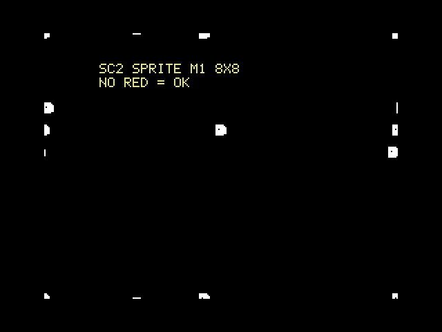

実機 V9958（FS-A1GT）のキャプチャ（参考。キャプチャ装置で上下の周辺部が切れています）:

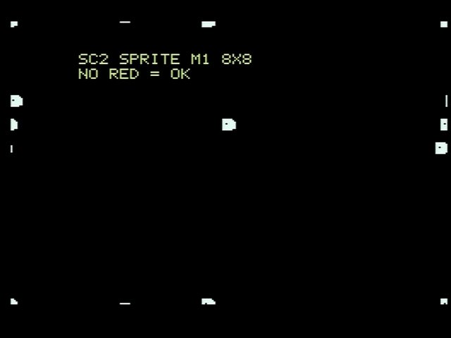

確認ポイント:

- [ ] 赤が1ドットも見えない（白いスプライトが赤い下絵を完全に覆う）
- [ ] 上端・下端・左端・右端でスプライトが欠けて見える（はみ出し部分は表示されない）

## P02 SC2 SPRITE M1 16X16 X2

SCREEN 2 / スプライトモード1 / 16x16 拡大

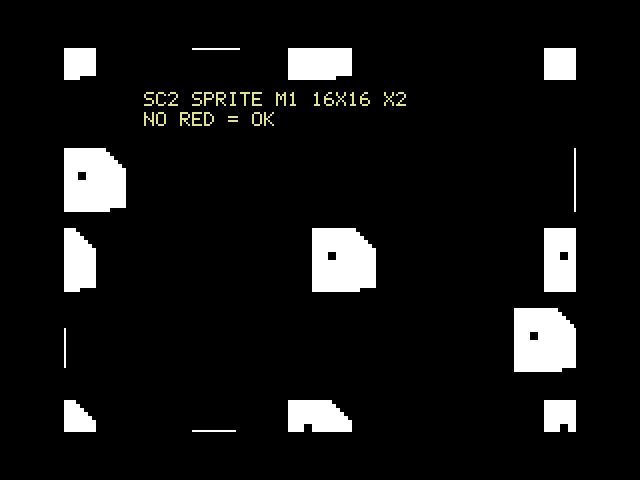

実機 V9958（FS-A1GT）のキャプチャ（参考。キャプチャ装置で上下の周辺部が切れています）:

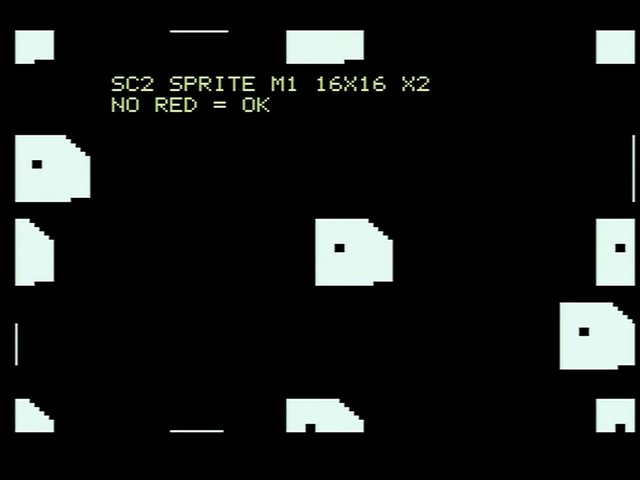

確認ポイント:

- [ ] 赤が見えない。拡大スプライトの端の欠け方が見本と同じ

## P03 SC5 SPRITE M2 16X16

SCREEN 5 / スプライトモード2 / 16x16 等倍 / 212ライン

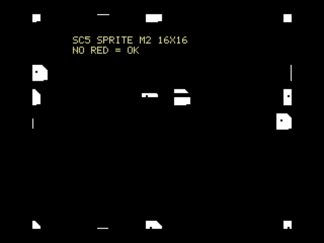

実機 V9958（FS-A1GT）のキャプチャ（参考。キャプチャ装置で上下の周辺部が切れています）:


確認ポイント:

- [ ] 赤が見えない。中央の段のスプライトは EC（32ドット左シフト）の行だけ左にずれている

## P04 SC6 SPRITE M2 16X16 X2

SCREEN 6 / スプライトモード2 / 16x16 拡大 / 212ライン

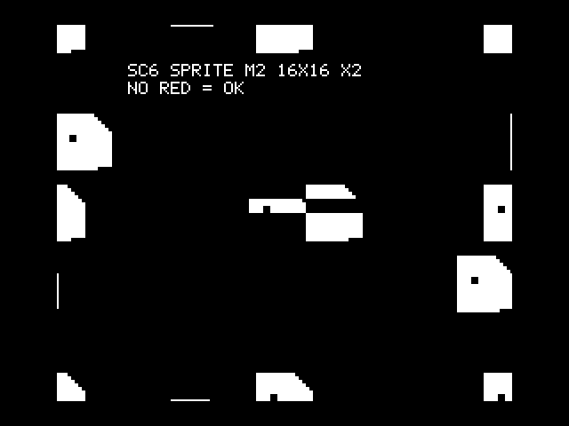

実機 V9958（FS-A1GT）のキャプチャ（参考。キャプチャ装置で上下の周辺部が切れています）:

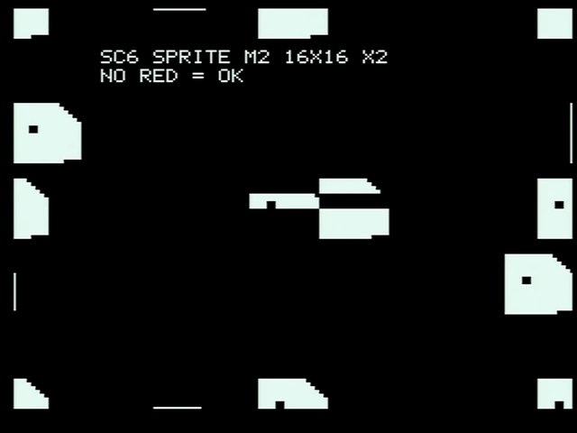

確認ポイント:

- [ ] 赤が見えない（SCREEN 6 は 512 ドットモード。スプライトは 2 ドット単位）

## P05 SC7 SPRITE M2 8X8 192L

SCREEN 7 / スプライトモード2 / 8x8 等倍 / 192ライン

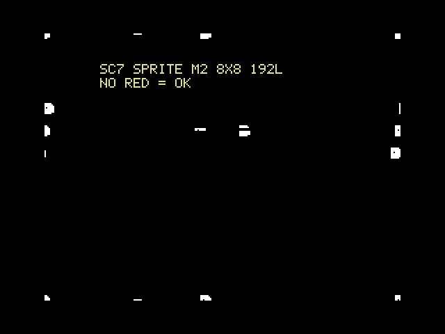

実機 V9958（FS-A1GT）のキャプチャ（参考。キャプチャ装置で上下の周辺部が切れています）:

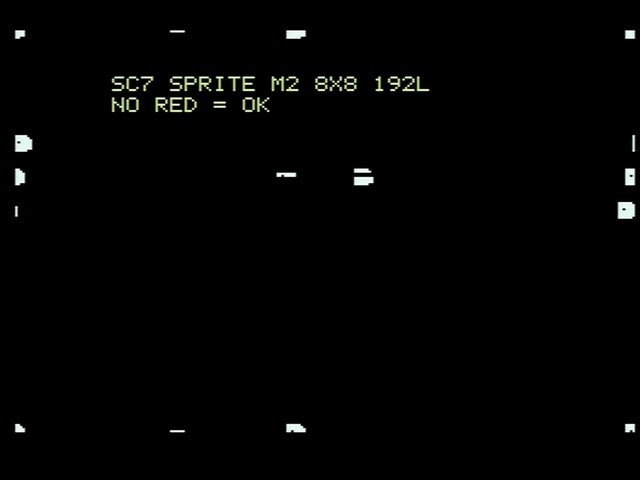

確認ポイント:

- [ ] 赤が見えない。192 ライン表示なので下端のスプライトはライン191で切れる

## P06 SC8 SPRITE M2 8X8 X2

SCREEN 8 / スプライトモード2 / 8x8 拡大 / 212ライン


実機 V9958（FS-A1GT）のキャプチャ（参考。キャプチャ装置で上下の周辺部が切れています）:

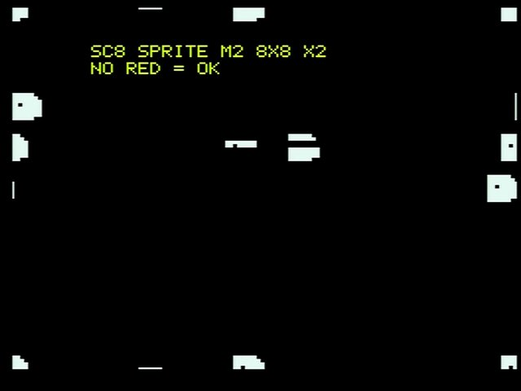

確認ポイント:

- [ ] 赤が見えない（SCREEN 8 の赤は GRB332 の 1Ch）

## P07 SC5 SPRITE COLOR

SCREEN 5 のスプライト色（色0〜15、TP=0/1、CC 合成、優先順位、9枚目非表示）

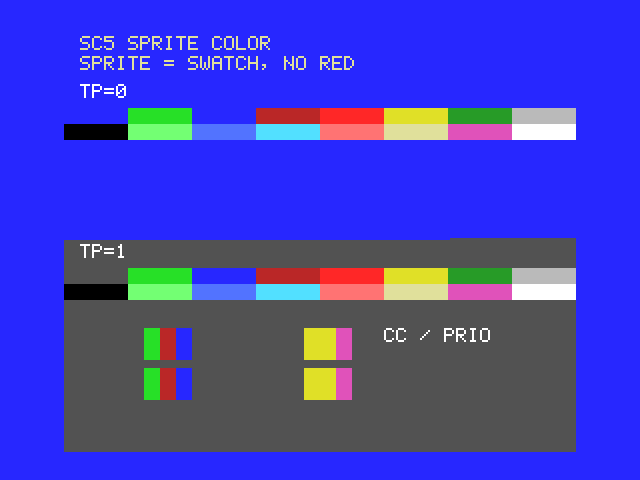

実機 V9958（FS-A1GT）のキャプチャ（参考。キャプチャ装置で上下の周辺部が切れています）:

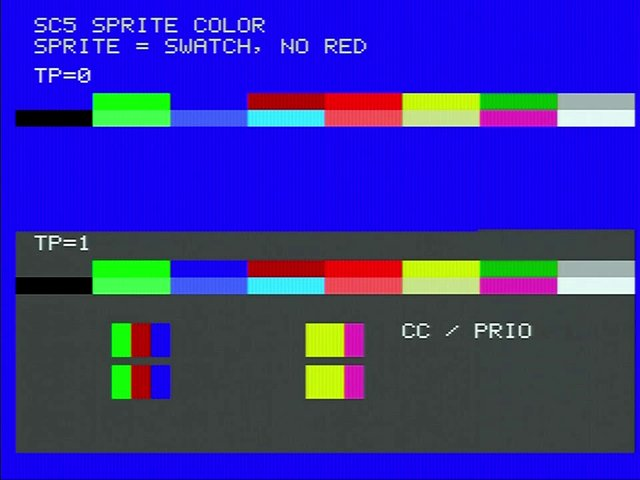

確認ポイント:

- [ ] 上段（TP=0）: スプライトとその右隣の見本が同じ色（16ドットずつ交互に並ぶ）。色0は透明
- [ ] 下段（TP=1）: 色0も灰色で表示される。ライン約105（行の途中）で TP が切り替わる
- [ ] 上段に赤いスプライト（9枚目）が出ない
- [ ] CC / PRIO: 左は緑(2)と CC 付きの青(4)の重なりが OR 合成で暗赤(6)、右は黄(10)が紫(13)より手前。下の見本と同じ
- [ ] 右下に赤（親のない CC スプライト）が出ない

## P08 SC6 BORDER + SPRITE

SCREEN 6 の周辺色（R#7 の値0〜15を12ラインごとに変更）とスプライト色

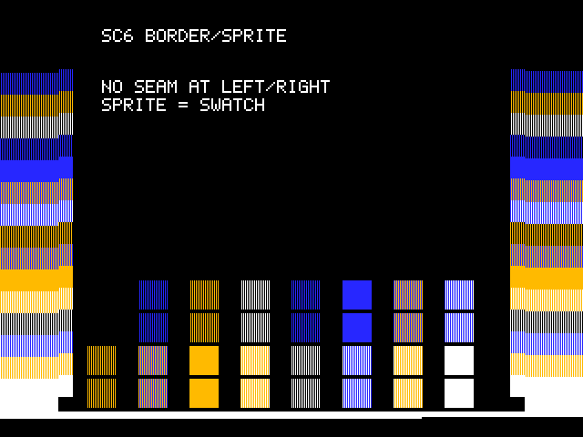

実機 V9958（FS-A1GT）のキャプチャ（参考。キャプチャ装置で上下の周辺部が切れています）:

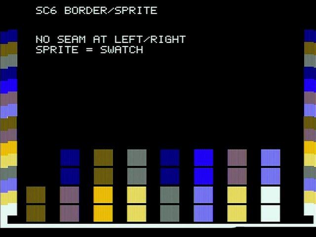

確認ポイント:

- [ ] 左右の周辺色の帯と、画面端の見本（偶数ドット=bit3-2、奇数ドット=bit1-0）が同じ行で同じ色
- [ ] スプライトの色が真下の見本と同じ
- [ ] 映像（特にキャプチャ）では、隣り合う2つの半ドットの色が混ざって見える（例: 黒+青で紺）。帯と見本、スプライトと見本が同じ色に見えればよい

## P09 SC8 BORDER + SPRITE

SCREEN 8 の周辺色（R#7 の GRB332 値）とスプライト固定16色

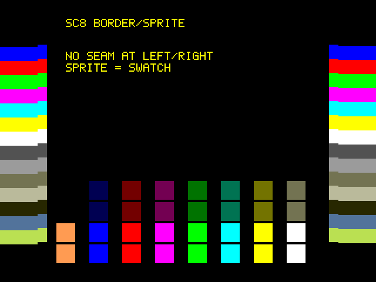

実機 V9958（FS-A1GT）のキャプチャ（参考。キャプチャ装置で上下の周辺部が切れています）:

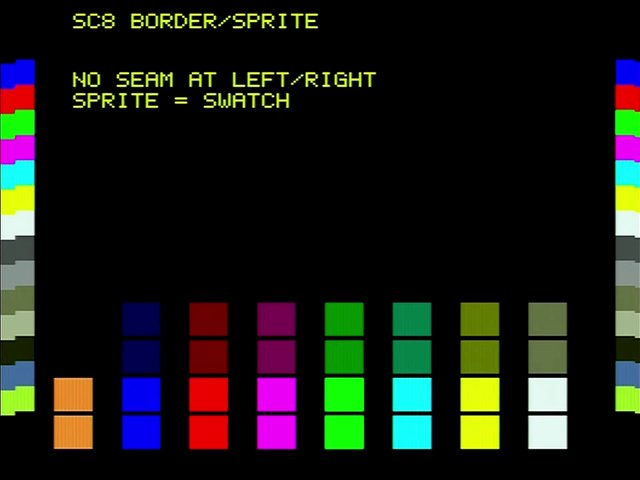

確認ポイント:

- [ ] 左右の周辺色（R#7 の GRB332 値）と画面端の見本が同じ行で同じ色
- [ ] スプライトが固定16色で表示され、真下の見本と同じ

## P10 SC11 BORDER + SPRITE

SCREEN 11（YJK+YAE）の周辺色（R#7 下位4ビットのパレット）とスプライト色（パレット）、YJK グラデーション

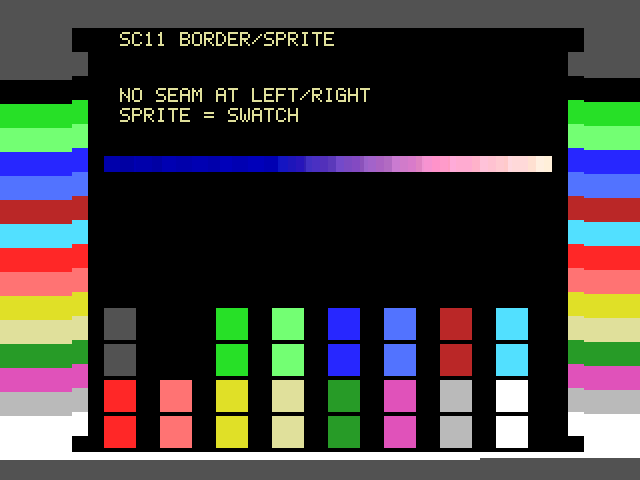

実機 V9958（FS-A1GT）のキャプチャ（参考。キャプチャ装置で上下の周辺部が切れています）:

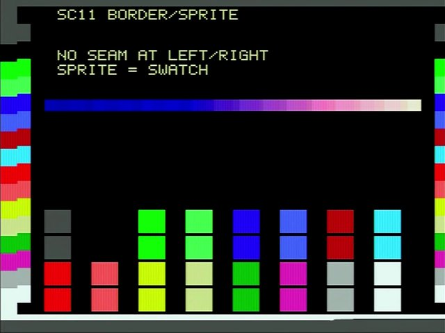

確認ポイント:

- [ ] 周辺色が R#7 下位4ビットのパレット色になる（上位4ビットは無視される）。画面端の見本と同じ色
- [ ] スプライトの色がパレット経由で、真下の見本と同じ（TP=1 なので色0は灰色）
- [ ] 中央の横帯は YJK のグラデーション（参考。破綻がないこと）

## P11 SC5 LINE INT BORDER

走査線割込み（16ラインごと、下の周辺部 214/230）で周辺色を変更

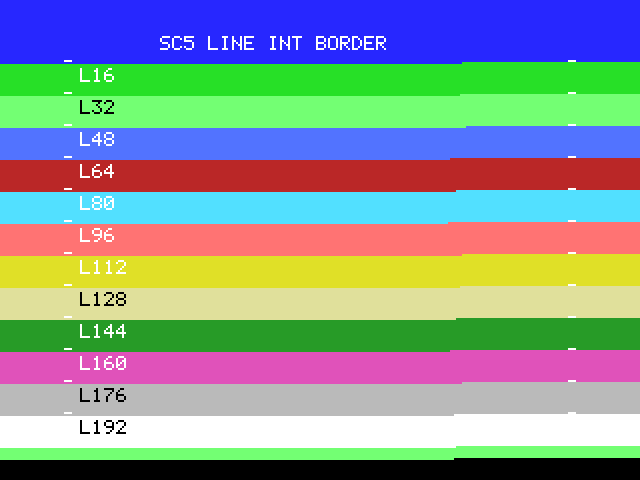

実機 V9958（FS-A1GT）のキャプチャ（参考。キャプチャ装置で上下の周辺部が切れています）:

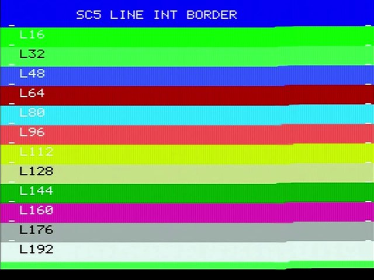

確認ポイント:

- [ ] 周辺色が 16 ラインごとに切り替わる（白い目印の行の右側で切り替わり、1〜2ライン遅れてよい）
- [ ] 下の周辺部（ライン214）で黒、上の周辺部は青になる
- [ ] 帯の位置がフレームごとに揺れない

## P12 SC5 LINE INT SCROLL

走査線割込みで R#23（ライン48: 64、ライン144: 200）と R#26/R#27（ライン96/112/128 で左へ 8/13/25 ドット）を変更

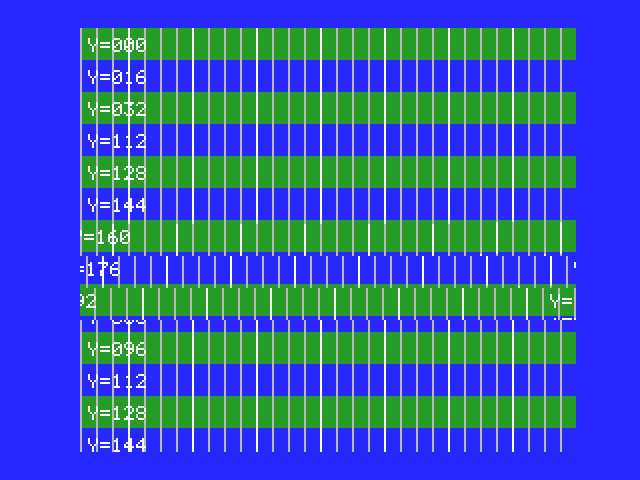

実機 V9958（FS-A1GT）のキャプチャ（参考。キャプチャ装置で上下の周辺部が切れています）:

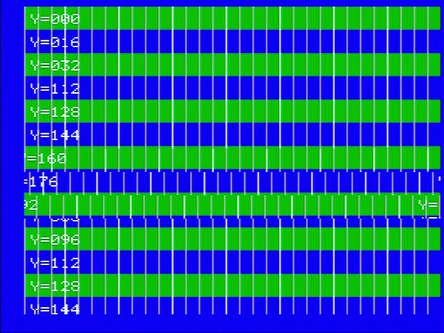

確認ポイント:

- [ ] ライン0〜47: Y=000〜032、ライン48〜: Y=112 から表示（R#23=64）
- [ ] ライン96/112/128 から横スクロール（左へ 8/13/25 ドット）。左8ドットはマスク
- [ ] ライン144〜: R#23=200 で VRAM ライン88（Y=080 の帯の途中）から、横スクロールなし
- [ ] 各帯の境目がフレームごとに揺れない

## P13 SC5 POLLING HR VR

S#2 の VR 立ち上がりで紫、立ち下がりで青、その後 HR を16回数えるごとに周辺色を変更

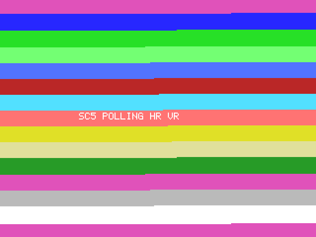

実機 V9958（FS-A1GT）のキャプチャ（参考。キャプチャ装置で上下の周辺部が切れています）:

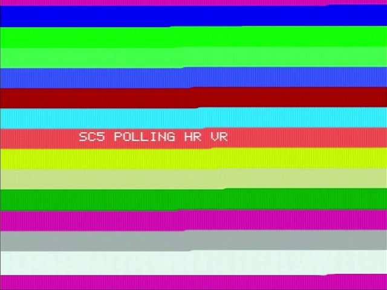

確認ポイント:

- [ ] 画面の一番上と一番下の周辺部が紫（VR 立ち上がり後）、上の周辺部の途中から青（VR 立ち下がり後）
- [ ] 表示期間で周辺色が帯状に切り替わり、切り替わり位置が少しずつ右にずれていく
- [ ] 帯の色の並びと、切り替わるラインがフレームごとに変わらない。切り替わる横位置は、ポーリングの検出タイミングによって数十ドット程度揺れてよい（実機 V9958 でも揺れる）

## P14 V9968 SC5 SPRITE MODE3

V9968: SCREEN 5 + スプライトモード3（上下左右の端、x2/x0.5/64x16/8x32 の拡縮、RVX/RVY、ドットごとの色）

期待画像（判定に使う）:

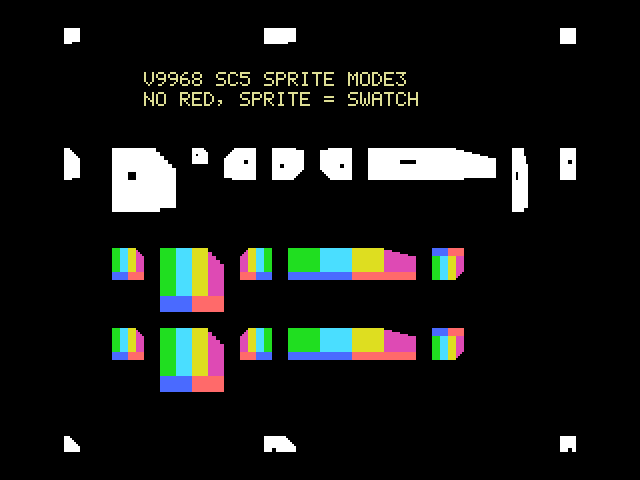

openMSX（Panasonic_FS-A1ST_V9968）のスクリーンショット（参考）:

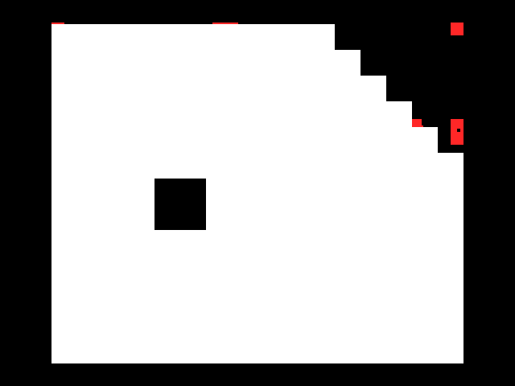

openMSX との違い: SP3 のスプライトが大きな白い領域として描かれ、赤い下絵も一部残ります。

確認ポイント:

- [ ] 赤が見えない（上下左右の端、x2、x0.5、64x16、8x32、RVX、RVY）
- [ ] 下の2段: カラフルなスプライト（ドットごとの色）と、その下の見本が同じ形・同じ色

## P15 V9968 SC8 EPAL PALETTE SET

V9968: SCREEN 8 + EPAL=1（スプライトモード2のパレットセット0〜15、R#7 をパレット番号として表示）

期待画像（判定に使う）:

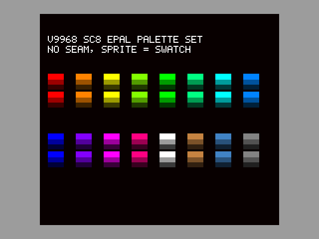

openMSX（Panasonic_FS-A1ST_V9968）のスクリーンショット（参考）:

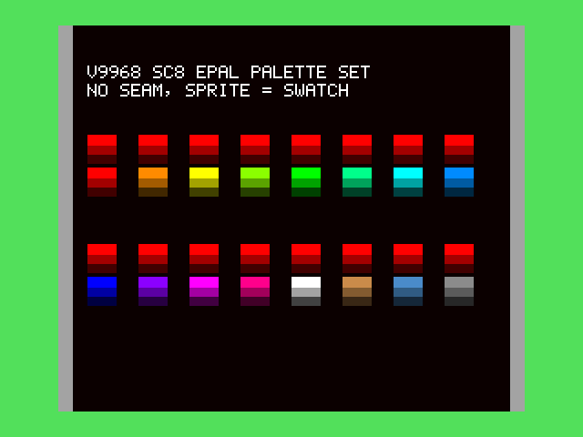

openMSX との違い: Mode2 のパレットセット（属性 +3）が反映されず、上段のスプライトがすべてパレットセット0（赤系）になります。

確認ポイント:

- [ ] 周辺色（灰色、パレット番号 C9h）と画面左右端の見本が同じ色
- [ ] スプライト（パレットセット0〜15）が、すぐ下の見本と同じ色

## P16 V9968 SC8 SPRITE TRANSLUCENT

V9968: SCREEN 8 + EPAL=1 + スプライトモード3 の半透明 TP0〜3（背景4色との合成）とパレットセット

期待画像（判定に使う）:

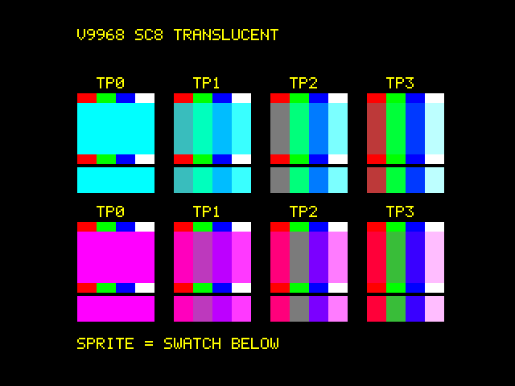

openMSX（Panasonic_FS-A1ST_V9968）のスクリーンショット（参考）:

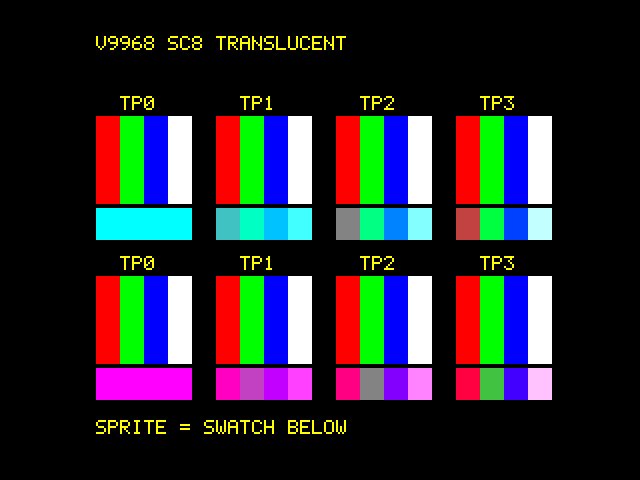

openMSX との違い: SP3 のスプライトが表示されず、背景の4色の帯と見本だけが見えます。

確認ポイント:

- [ ] TP0〜3 の各スプライトが、すぐ下の見本と同じ色（背景4色との合成）
- [ ] スプライトの上下にはみ出した背景の帯は元の色のまま

## P17 SC12 BORDER + SPRITE

SCREEN 12（YJK、YAE=0）の周辺色（R#7 下位4ビットのパレット）。画面端のスプライト（パレット色）と比べる

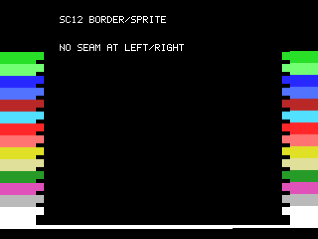

確認ポイント:

- [ ] 左右の周辺色の帯と、画面端のスプライトが同じ行で同じ色（つなぎ目が見えない）。周辺色は R#7 下位4ビットのパレット色で、上位4ビットは無視される
- [ ] 一番上の帯（R#7=F0h）と下の周辺部は黒（パレット0）

## ビルド

```
build.bat
```

gen_vdpview.py が VDPVIEW.INC と VDPVIEW.md（P14〜P16 の期待画像も）を生成し、zma で VDPVIEW.COM を作ります。
