# VDPVIEW — VDP 目視確認テスト

VDPVIEW.COM と VDPINT.COM は、VDP の表示を目視確認する MSX-DOS 用プログラムです。
本物の V9958 と同じ見え方になるかを、少ない確認箇所で判定できるように作っています。

## 使い方

```
A>VDPVIEW    ... P01〜P19
A>VDPINT     ... P20〜P23（走査線割込み）
```

| キー | 動作 |
|---|---|
| SPACE / RETURN / → | 次のページ |
| BS / ← | 前のページ |
| ESC | 終了（画面をテキストに戻して DOS へ） |

- 各実行ファイルの最後のページで次へ進むと終了します。P20〜P23 は `VDPINT` を別途起動してください。
- V9938 では起動しません。V9958 では V9968 専用ページ（タイトルが V9968 で始まるもの）を飛ばします。
- turboR では Z80 モードに切り替えて実行し、終了時に元の CPU モードに戻します。

## ハング調査用 VDPDIAG

`VDPDIAG.COM` は画面切り替え時の低頻度ハングを調べる診断版です。通常版 `VDPVIEW.COM` は変更しません。
起動後に `1`（P11→P12）または `2`（P06→P07）を選ぶと、選んだ遷移を1000回自動で繰り返します。P07/P11/P12 の走査線割込みと終了処理も実行します。各ページの表示時間は変化させています。
参考として、openMSX の Z80 モードでは起動から終了まで約26〜28分でした。実機では VDP や WAIT により変わります。
左上の `A0001` / `B0001` は、遷移元 A・遷移先 B と実行中の回数です。表示が消えた後は文字も見えなくなるため、停止直前の表示を録画しておくと役立ちます。
表示OFF中の R#7 は、準備中 03h、1回目の VRAM クリア中 05h、2回目のクリア中 08h、ページデータの実行開始時 0Ah に設定します。SCREEN 5 の標準パレットでは順に緑・青・赤・黄です。色は画面モードやパレットによって変わり、ページ側が R#7 を書くと上書きされるため、色だけで停止箇所を断定できません。
ESC で中止できます。1000回完了または中止した場合は DOS に戻り、完了した遷移数を表示します。CPU が停止した場合は ESC では復帰できません。
VDP コマンドの CE 待ちで S#2 の bit 0 が 1 のまま 1,048,576 回読み取れた場合、その時点の状態を記録し、VDP を調べてから DOS のテキスト画面に戻して診断結果を表示します。検出までの時間は CPU と WAIT に依存し、Z80 の約3.58MHz では少なくとも約14秒です。
記録・調査の順序は次のとおりです。

1. VDP へ書かずに S#2 を連続で読む（16回の生値、65535回の AND/OR と CE=0 の回数）。R#15=2 を再設定して再度読む。S#0〜S#15、ポート 9Ch、0038h〜003Ah も記録する。
2. R#7=0Ch にして R#46=0（STOP）を書き、CE が 0 になるまでの読み取り回数を調べる。
3. R#7=0Eh にして VRAM 前半・後半 64KB の非0バイトの先頭・末尾・個数を調べる（HMMV のクリアがどこまで進んだかの目安）。
4. R#7=0Fh にして (0,1023) へ 5Ah を書く HMMV を再実行し、完了とVRAM の値を確認する。

結果には、回数・遷移・段階・呼び出し元・コマンドレジスタ・S#2 の値・STOP/再実行の結果、VDPDIAG が最後に書いた R#0〜R#63 の値（未書き込みは `--`）と直近16回のレジスタ書き込み履歴を含みます。22行ごとに `-- HIT ANY KEY --` で止まり、全表示後に現在のドライブへ `VDPDIAG.LOG` として保存してから DOS に戻ります。R#14 の直接書き込みとページ側の一部の出力はレジスタ値の記録対象外です。
テキスト画面に戻らない場合は、境界色で止まった段階を推定できます（0Ch: STOP 調査、0Eh: VRAM 調査、0Fh: 再実行）。CE 待ち以外で停止した場合は結果を表示できないため、停止時の直前のページ、画面、LED を記録してください。
診断版の実行ファイルは、TPA に収めるため使用しないページの本体を空にしています。
診断版は回数表示や段階表示のため VDP アクセスを追加し、待ち時間も通常版と異なります。ハングしなくても正常の証明にはなりません。

## 判定の基本

- **赤が見えたら NG**: 端の表示のページでは、スプライトが乗るはずの位置に赤い下絵を描いています。スプライトが正しい位置・形で表示されれば、赤は完全に隠れます。
- **スプライト = 見本**: 色のページでは、スプライトのすぐ下（または画面端）に、期待される色の見本を背景で描いています。
- 走査線割込み・ポーリングのページは、切り替え位置が 1〜2 ライン遅れたり行の途中になったりするのは正常です。切り替わるラインがフレームごとに揺れないことを確認します（ポーリングのページの横位置の揺れは正常）。

## P20〜P23 走査線割込みの取りこぼしチェック

`VDPINT.COM` を実行すると P20 から順番に表示します。P20/P21 は192/212ラインの互換モード（R#19=(画面Y+R#23) mod 256）、P22/P23 はV9968専用のILNS=1（R#20 bit2、R#19=画面Y）です。各ページ内で画面YとR#23を自動巡回し、約1秒ずつ同じ設定を保持します。通常の次／前／終了キーが使えます。

- 画面Y: 0〜7、表示最終行の前後4行（192ラインでは187〜195、212ラインでは207〜215）、下の周辺部（192ラインでは208/216/223、212ラインでは223/230/234）。R#23: 00h/01h/40h/C8h/FFh。R#19の8bit折り返しも含め、1ページ100条件を繰り返します。
- パネルのY/R23/R19は16進数です。パネルはR#23に合わせてVRAM上の位置を変え、画面中央に表示します。Nは通常 `----`、赤になったときは最初の失敗時の受信回数を16進4桁で表示します（正常値は `0040`）。
- 周辺色と左右の幅広い帯は、垂直割込みで青、試験対象の走査線割込みで緑にします。上端の割込みなら画面の大部分が緑、下端の割込みなら大部分が青になります。下の周辺部がキャプチャで切れても、回数チェックで確認できます。
- 設定直後の2フレームを除外し、その後64フレームの走査線割込み回数を64と比較します。集計は垂直割込みのISR内ではなく、試験対象の下端の走査線を過ぎ、次の上端に到達する前に行います。取りこぼし／余分な割込みを検出したら赤を保持し、自動巡回を停止して失敗条件を表示します。赤になった画面のY/R23/R19/Nとページ番号を記録してください。
- R#19は試験中に再設定しません。ISRはS#1とS#0を読み、BIOSを経由せずに割込みを処理します。垂直割込みと近接する表示最終行も除外しないため、その境界でFHが消える問題も検出対象です。条件の切り替え時だけ短時間DIにし、パネル更新を行います。この切り替え時の表示変化は正常です。
- 60Hz・非インターレース・通常速度のZ80モード（約3.58MHz）で試験します。CPUの高速化・低速化は集計時刻を変えるため使用しないでください。これは割込みをCPUが受け取れたかの試験であり、厳密な発生座標の自動判定ではありません。

## 参照画像について

- P01〜P13 は openMSX（Panasonic FS-A1GT、V9958）のスクリーンショットです。実機 V9958（FS-A1GT）でも同じ見え方になることを確認済みで、そのキャプチャも並べています。
- P17 は後から追加したページで、openMSX（Panasonic FS-A1GT、V9958）のスクリーンショットです。
- P18（V9968 専用）は後から追加したページで、期待画像（V9968 マニュアルと RTL に基づく）だけを載せています。openMSX はこのページの SP3 スプライトを描画しないため、スクリーンショットはありません。
- P19（V9968 専用）は後から追加したページで、期待画像と openMSX（Panasonic_FS-A1ST_V9968）のスクリーンショットを載せています。判定には期待画像を使います。
- P14〜P16（V9968 専用）は、openMSX（Panasonic_FS-A1ST_V9968）のスクリーンショットと、生成器 gen_vdpview.py のモデルから描いた期待画像（V9968 マニュアルと RTL に基づく）の両方を載せています。判定には期待画像を使います。
- openMSX の Panasonic_FS-A1ST_V9968 は Port#4 の読み出しで FFh を返すため、VDPVIEW は V9968 と判定しません。スクリーンショットは、撮影用スクリプトでメモリ上の判定結果を V9968 に書き換えて撮りました。
- openMSX の V9968 実装は正解の基準にしません。openMSX と見え方が違っても、それを理由に FPGA を修正しないでください。

## ページ一覧

| No. | タイトル | 内容 |
|---|---|---|
| P01 | SC2 SPRITE M1 8X8 | SCREEN 2 / スプライトモード1 / 8x8 等倍 |
| P02 | SC2 SPRITE M1 16X16 X2 | SCREEN 2 / スプライトモード1 / 16x16 拡大 |
| P03 | SC5 SPRITE M2 16X16 | SCREEN 5 / スプライトモード2 / 16x16 等倍 / 212ライン |
| P04 | SC6 SPRITE M2 16X16 X2 | SCREEN 6 / スプライトモード2 / 16x16 拡大 / 212ライン |
| P05 | SC7 SPRITE M2 8X8 192L | SCREEN 7 / スプライトモード2 / 8x8 等倍 / 192ライン |
| P06 | SC8 SPRITE M2 8X8 X2 | SCREEN 8 / スプライトモード2 / 8x8 拡大 / 212ライン |
| P07 | SC5 SPRITE COLOR | SCREEN 5 のスプライト色（色0〜15、TP=0/1、CC 合成、優先順位、9枚目非表示） |
| P08 | SC6 BORDER + SPRITE | SCREEN 6 の周辺色（R#7 の値0〜15を12ラインごとに変更）とスプライト色 |
| P09 | SC8 BORDER + SPRITE | SCREEN 8 の周辺色（R#7 の GRB332 値）とスプライト固定16色 |
| P10 | SC11 BORDER + SPRITE | SCREEN 11（YJK+YAE）の周辺色（R#7 下位4ビットのパレット）とスプライト色（パレット）、YJK グラデーション |
| P11 | SC5 LINE INT BORDER | 走査線割込み（16ラインごと、下の周辺部 214/230）で周辺色を変更 |
| P12 | SC5 LINE INT SCROLL | 走査線割込みで R#23（ライン48: 64、ライン144: 200）と R#26/R#27（ライン96/112/128 で左へ 8/13/25 ドット）を変更 |
| P13 | SC5 POLLING HR VR | S#2 の VR 立ち上がりで紫、立ち下がりで青、その後 HR を16回数えるごとに周辺色を変更 |
| P14 | V9968 SC5 SPRITE MODE3 | V9968: SCREEN 5 + スプライトモード3（上下左右の端、x2/x0.5/64x16/8x32 の拡縮、RVX/RVY、ドットごとの色） |
| P15 | V9968 SC8 EPAL PALETTE SET | V9968: SCREEN 8 + EPAL=1（スプライトモード2のパレットセット0〜15、R#7 をパレット番号として表示） |
| P16 | V9968 SC8 SPRITE TRANSLUCENT | V9968: SCREEN 8 + EPAL=1 + スプライトモード3 の半透明 TP0〜3（背景4色との合成）とパレットセット |
| P17 | SC12 BORDER + SPRITE | SCREEN 12（YJK、YAE=0）の周辺色（R#7 下位4ビットのパレット）。画面端のスプライト（パレット色）と比べる |
| P18 | V9968 SC8 SP3 FIXED COLOR | V9968: SCREEN 8（EPAL=0）+ スプライトモード3。固定16色（パレットセット指定は無視）と、GRB332 背景との半透明 TP0〜3 |
| P19 | V9968 SC5 SP3 SCROLL SEAM | V9968: SCREEN 5 + スプライトモード3、SVNS=0、R#23=100。背景の周回の継ぎ目（VRAM ライン255→0、画面ライン156）をまたぐスプライトが途切れず、Y=256〜767 のスプライトは表示されない |
| P20 | SC5 INT EDGE COMPAT 192 | 走査線割込みの上端・下端チェック。192ライン、R#23依存（互換モード）。画面YとR#23を自動巡回し、64フレームの割込み回数が64でなければ赤を保持する。 |
| P21 | SC5 INT EDGE COMPAT 212 | 走査線割込みの上端・下端チェック。212ライン、R#23依存（互換モード）。画面YとR#23を自動巡回し、64フレームの割込み回数が64でなければ赤を保持する。 |
| P22 | V9968 SC5 INT EDGE ILNS 192 | 走査線割込みの上端・下端チェック。192ライン、R#23非依存（ILNS=1）。画面YとR#23を自動巡回し、64フレームの割込み回数が64でなければ赤を保持する。 |
| P23 | V9968 SC5 INT EDGE ILNS 212 | 走査線割込みの上端・下端チェック。212ライン、R#23非依存（ILNS=1）。画面YとR#23を自動巡回し、64フレームの割込み回数が64でなければ赤を保持する。 |

## P01 SC2 SPRITE M1 8X8

SCREEN 2 / スプライトモード1 / 8x8 等倍

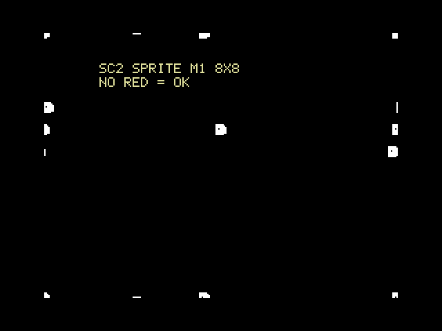

実機 V9958（FS-A1GT）のキャプチャ（参考。キャプチャ装置で上下の周辺部が切れています）:

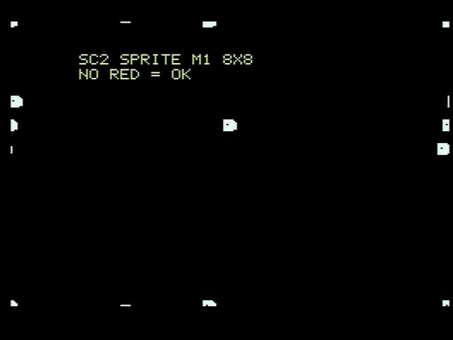

確認ポイント:

- [ ] 赤が1ドットも見えない（白いスプライトが赤い下絵を完全に覆う）
- [ ] 上端・下端・左端・右端でスプライトが欠けて見える（はみ出し部分は表示されない）

## P02 SC2 SPRITE M1 16X16 X2

SCREEN 2 / スプライトモード1 / 16x16 拡大

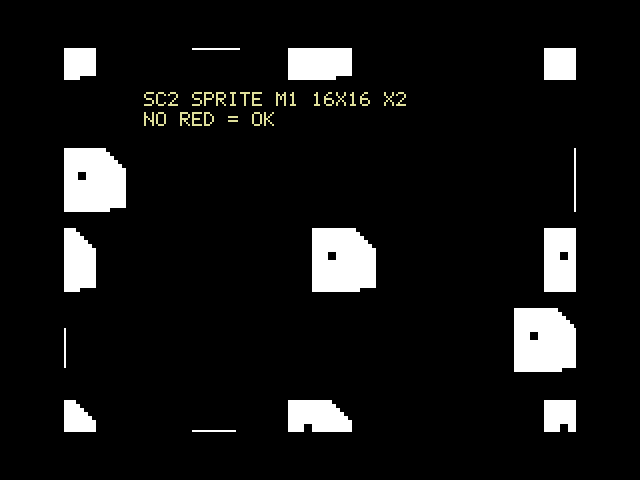

実機 V9958（FS-A1GT）のキャプチャ（参考。キャプチャ装置で上下の周辺部が切れています）:

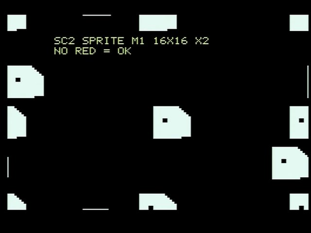

確認ポイント:

- [ ] 赤が見えない。拡大スプライトの端の欠け方が見本と同じ

## P03 SC5 SPRITE M2 16X16

SCREEN 5 / スプライトモード2 / 16x16 等倍 / 212ライン

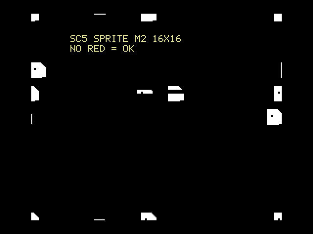

実機 V9958（FS-A1GT）のキャプチャ（参考。キャプチャ装置で上下の周辺部が切れています）:


確認ポイント:

- [ ] 赤が見えない。中央の段のスプライトは EC（32ドット左シフト）の行だけ左にずれている

## P04 SC6 SPRITE M2 16X16 X2

SCREEN 6 / スプライトモード2 / 16x16 拡大 / 212ライン

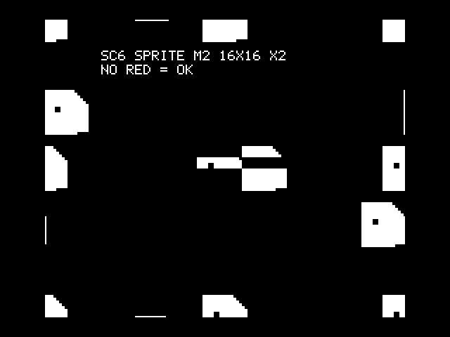

実機 V9958（FS-A1GT）のキャプチャ（参考。キャプチャ装置で上下の周辺部が切れています）:

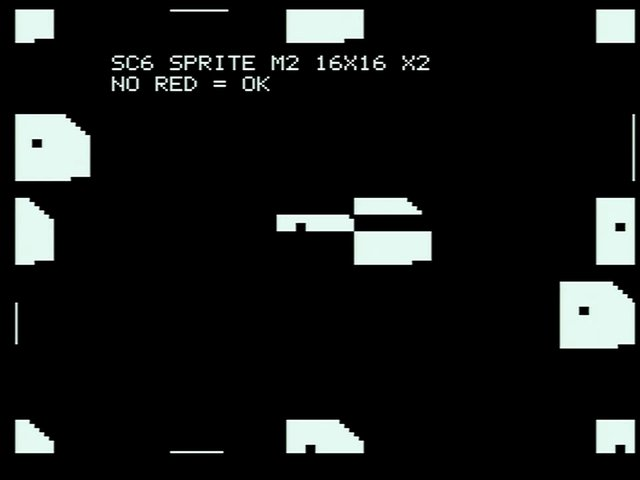

確認ポイント:

- [ ] 赤が見えない（SCREEN 6 は 512 ドットモード。スプライトは 2 ドット単位）

## P05 SC7 SPRITE M2 8X8 192L

SCREEN 7 / スプライトモード2 / 8x8 等倍 / 192ライン

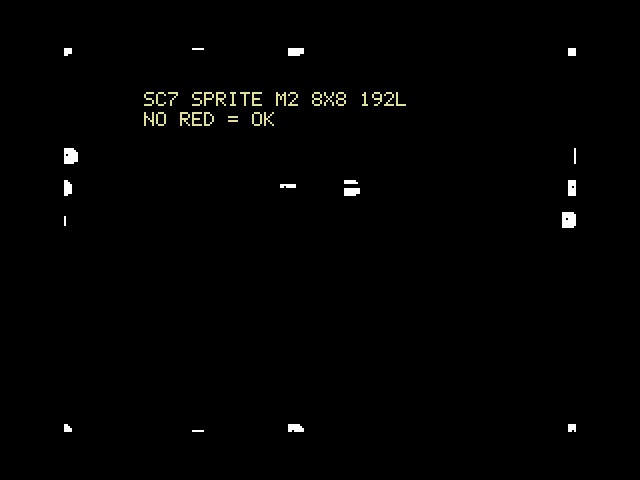

実機 V9958（FS-A1GT）のキャプチャ（参考。キャプチャ装置で上下の周辺部が切れています）:

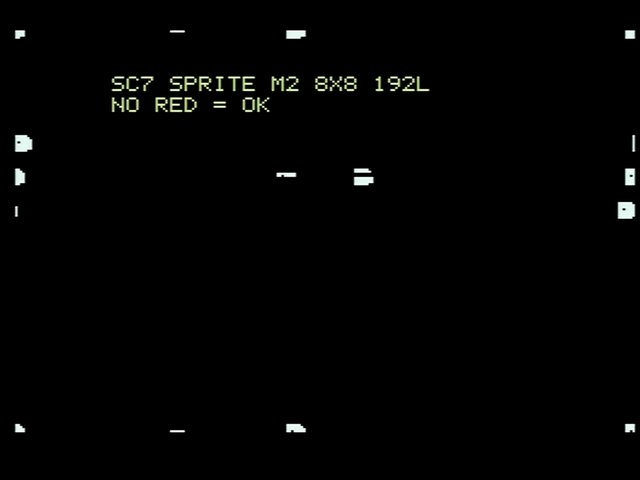

確認ポイント:

- [ ] 赤が見えない。192 ライン表示なので下端のスプライトはライン191で切れる

## P06 SC8 SPRITE M2 8X8 X2

SCREEN 8 / スプライトモード2 / 8x8 拡大 / 212ライン


実機 V9958（FS-A1GT）のキャプチャ（参考。キャプチャ装置で上下の周辺部が切れています）:

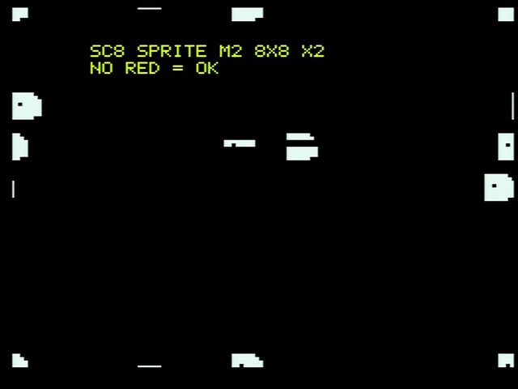

確認ポイント:

- [ ] 赤が見えない（SCREEN 8 の赤は GRB332 の 1Ch）

## P07 SC5 SPRITE COLOR

SCREEN 5 のスプライト色（色0〜15、TP=0/1、CC 合成、優先順位、9枚目非表示）

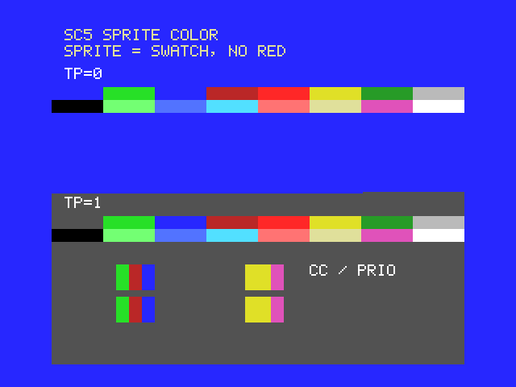

実機 V9958（FS-A1GT）のキャプチャ（参考。キャプチャ装置で上下の周辺部が切れています）:

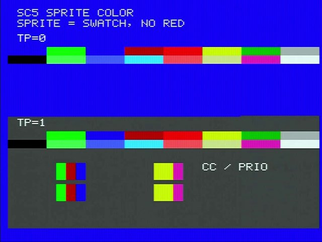

確認ポイント:

- [ ] 上段（TP=0）: スプライトとその右隣の見本が同じ色（16ドットずつ交互に並ぶ）。色0は透明
- [ ] 下段（TP=1）: 色0も灰色で表示される。ライン約105（行の途中）で TP が切り替わる
- [ ] 上段に赤いスプライト（9枚目）が出ない
- [ ] CC / PRIO: 左は緑(2)と CC 付きの青(4)の重なりが OR 合成で暗赤(6)、右は黄(10)が紫(13)より手前。下の見本と同じ
- [ ] 右下に赤（親のない CC スプライト）が出ない

## P08 SC6 BORDER + SPRITE

SCREEN 6 の周辺色（R#7 の値0〜15を12ラインごとに変更）とスプライト色

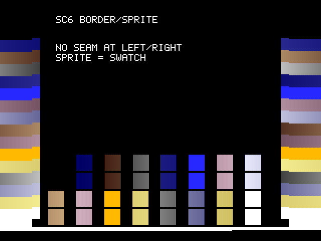

実機 V9958（FS-A1GT）のキャプチャ（参考。キャプチャ装置で上下の周辺部が切れています）:

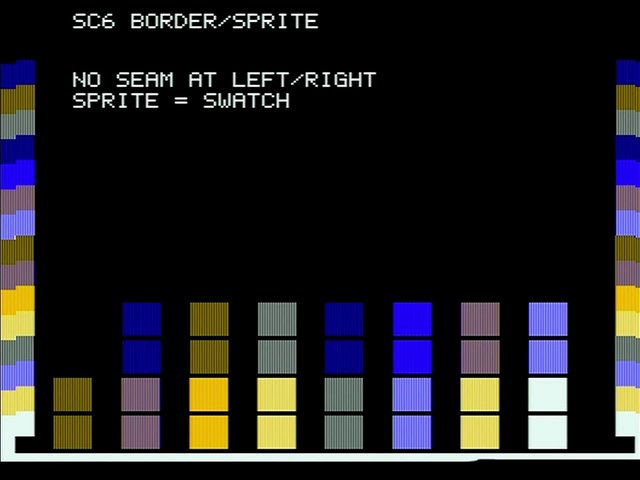

確認ポイント:

- [ ] 左右の周辺色の帯と、画面端の見本（偶数ドット=bit3-2、奇数ドット=bit1-0）が同じ行で同じ色
- [ ] スプライトの色が真下の見本と同じ
- [ ] 映像（特にキャプチャ）では、隣り合う2つの半ドットの色が混ざって見える（例: 黒+青で紺）。帯と見本、スプライトと見本が同じ色に見えればよい

## P09 SC8 BORDER + SPRITE

SCREEN 8 の周辺色（R#7 の GRB332 値）とスプライト固定16色

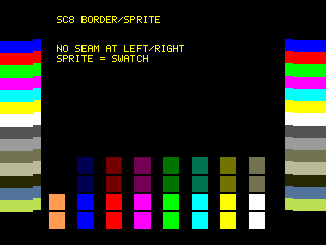

実機 V9958（FS-A1GT）のキャプチャ（参考。キャプチャ装置で上下の周辺部が切れています）:

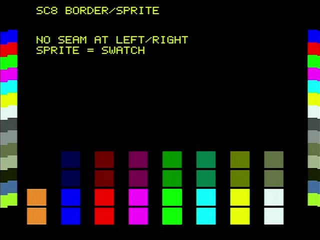

確認ポイント:

- [ ] 左右の周辺色（R#7 の GRB332 値）と画面端の見本が同じ行で同じ色
- [ ] スプライトが固定16色で表示され、真下の見本と同じ

## P10 SC11 BORDER + SPRITE

SCREEN 11（YJK+YAE）の周辺色（R#7 下位4ビットのパレット）とスプライト色（パレット）、YJK グラデーション

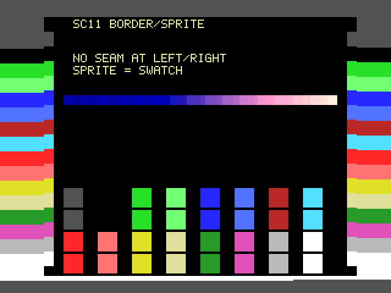

実機 V9958（FS-A1GT）のキャプチャ（参考。キャプチャ装置で上下の周辺部が切れています）:

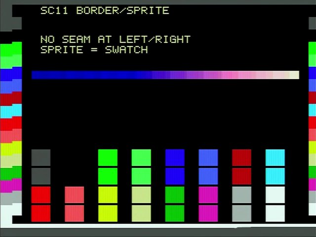

確認ポイント:

- [ ] 周辺色が R#7 下位4ビットのパレット色になる（上位4ビットは無視される）。画面端の見本と同じ色
- [ ] スプライトの色がパレット経由で、真下の見本と同じ（TP=1 なので色0は灰色）
- [ ] 中央の横帯は YJK のグラデーション（参考。破綻がないこと）

## P11 SC5 LINE INT BORDER

走査線割込み（16ラインごと、下の周辺部 214/230）で周辺色を変更

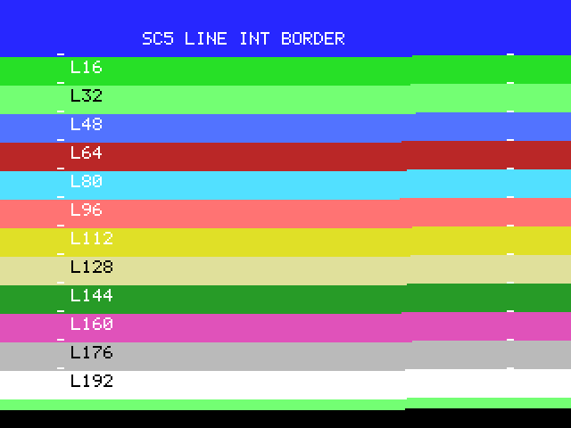

実機 V9958（FS-A1GT）のキャプチャ（参考。キャプチャ装置で上下の周辺部が切れています）:

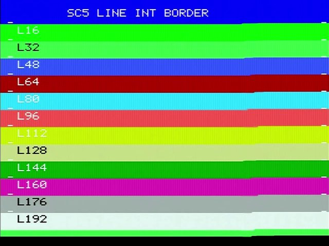

確認ポイント:

- [ ] 周辺色が 16 ラインごとに切り替わる（白い目印の行の右側で切り替わり、1〜2ライン遅れてよい）
- [ ] 下の周辺部（ライン214）で黒、上の周辺部は青になる
- [ ] 帯の位置がフレームごとに揺れない

## P12 SC5 LINE INT SCROLL

走査線割込みで R#23（ライン48: 64、ライン144: 200）と R#26/R#27（ライン96/112/128 で左へ 8/13/25 ドット）を変更

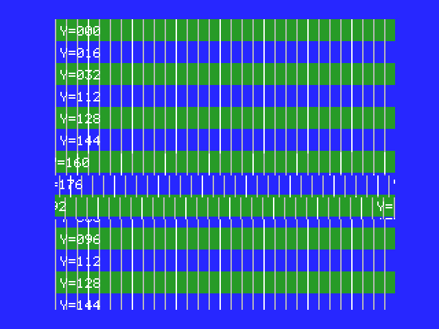

実機 V9958（FS-A1GT）のキャプチャ（参考。キャプチャ装置で上下の周辺部が切れています）:

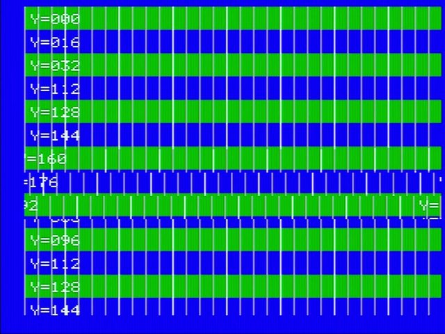

確認ポイント:

- [ ] ライン0〜47: Y=000〜032、ライン48〜: Y=112 から表示（R#23=64）
- [ ] ライン96/112/128 から横スクロール（左へ 8/13/25 ドット）。左8ドットはマスク
- [ ] ライン144〜: R#23=200 で VRAM ライン88（Y=080 の帯の途中）から、横スクロールなし
- [ ] 各帯の境目がフレームごとに揺れない

## P13 SC5 POLLING HR VR

S#2 の VR 立ち上がりで紫、立ち下がりで青、その後 HR を16回数えるごとに周辺色を変更


実機 V9958（FS-A1GT）のキャプチャ（参考。キャプチャ装置で上下の周辺部が切れています）:

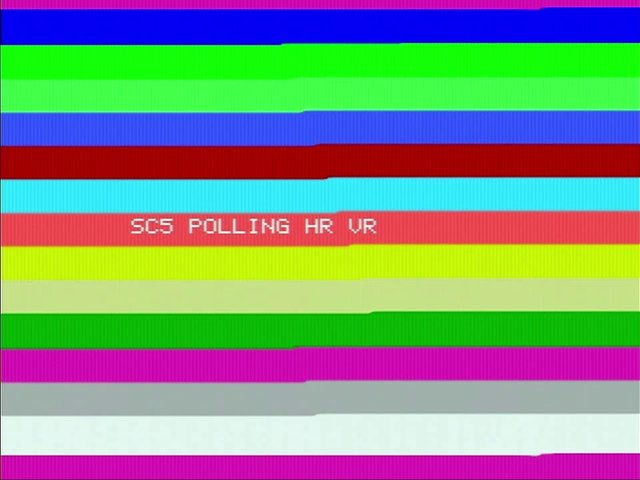

確認ポイント:

- [ ] 画面の一番上と一番下の周辺部が紫（VR 立ち上がり後）、上の周辺部の途中から青（VR 立ち下がり後）
- [ ] 表示期間で周辺色が帯状に切り替わり、切り替わり位置が少しずつ右にずれていく
- [ ] 帯の色の並びと、切り替わるラインがフレームごとに変わらない。切り替わる横位置は、ポーリングの検出タイミングによって数十ドット程度揺れてよい（実機 V9958 でも揺れる）

## P14 V9968 SC5 SPRITE MODE3

V9968: SCREEN 5 + スプライトモード3（上下左右の端、x2/x0.5/64x16/8x32 の拡縮、RVX/RVY、ドットごとの色）

期待画像（判定に使う）:

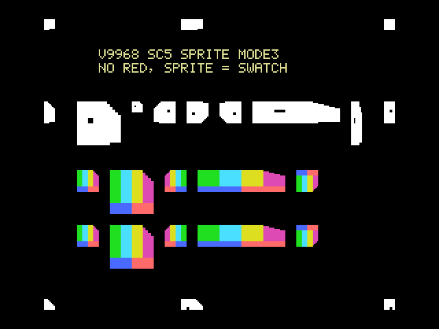

openMSX（Panasonic_FS-A1ST_V9968）のスクリーンショット（参考）:


openMSX との違い: SP3 のスプライトが大きな白い領域として描かれ、赤い下絵も一部残ります。

確認ポイント:

- [ ] 赤が見えない（上下左右の端、x2、x0.5、64x16、8x32、RVX、RVY）
- [ ] 下の2段: カラフルなスプライト（ドットごとの色）と、その下の見本が同じ形・同じ色

## P15 V9968 SC8 EPAL PALETTE SET

V9968: SCREEN 8 + EPAL=1（スプライトモード2のパレットセット0〜15、R#7 をパレット番号として表示）

期待画像（判定に使う）:

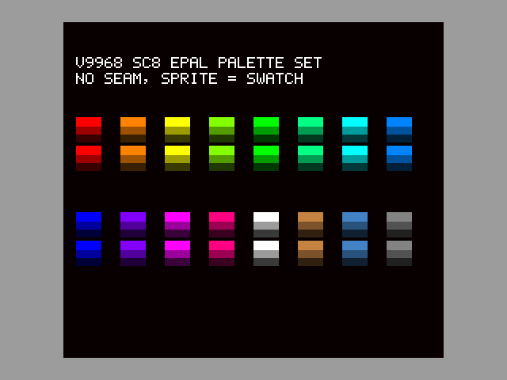

openMSX（Panasonic_FS-A1ST_V9968）のスクリーンショット（参考）:

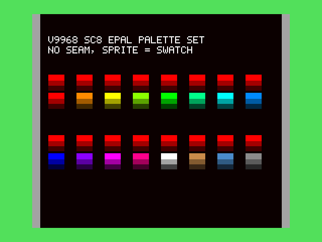

openMSX との違い: Mode2 のパレットセット（属性 +3）が反映されず、上段のスプライトがすべてパレットセット0（赤系）になります。

確認ポイント:

- [ ] 周辺色（灰色、パレット番号 C9h）と画面左右端の見本が同じ色
- [ ] スプライト（パレットセット0〜15）が、すぐ下の見本と同じ色

## P16 V9968 SC8 SPRITE TRANSLUCENT

V9968: SCREEN 8 + EPAL=1 + スプライトモード3 の半透明 TP0〜3（背景4色との合成）とパレットセット

期待画像（判定に使う）:

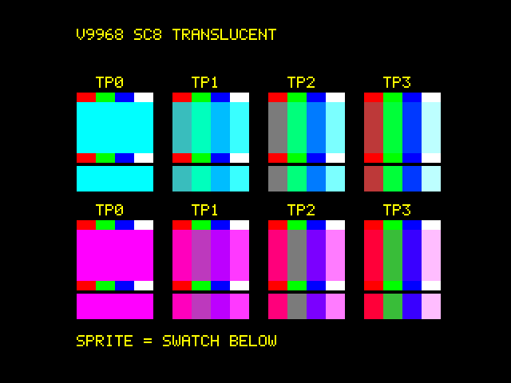

openMSX（Panasonic_FS-A1ST_V9968）のスクリーンショット（参考）:

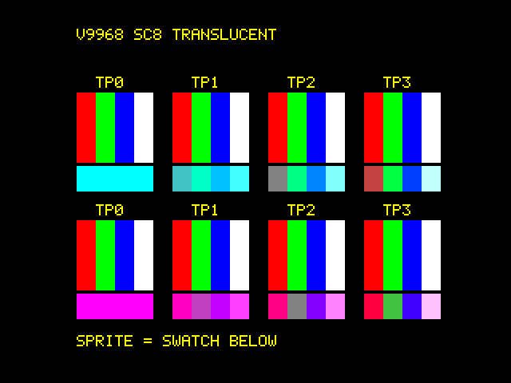

openMSX との違い: SP3 のスプライトが表示されず、背景の4色の帯と見本だけが見えます。

確認ポイント:

- [ ] TP0〜3 の各スプライトが、すぐ下の見本と同じ色（背景4色との合成）
- [ ] スプライトの上下にはみ出した背景の帯は元の色のまま

## P17 SC12 BORDER + SPRITE

SCREEN 12（YJK、YAE=0）の周辺色（R#7 下位4ビットのパレット）。画面端のスプライト（パレット色）と比べる

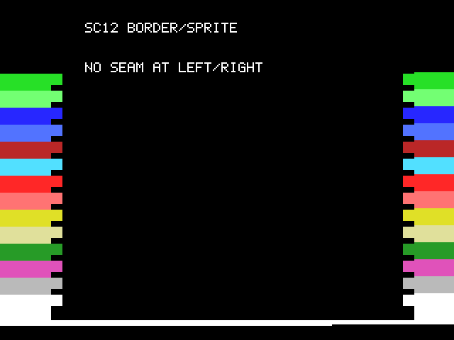

確認ポイント:

- [ ] 左右の周辺色の帯と、画面端のスプライトが同じ行で同じ色（つなぎ目が見えない）。周辺色は R#7 下位4ビットのパレット色で、上位4ビットは無視される
- [ ] 一番上の帯（R#7=F0h）と下の周辺部は黒（パレット0）

## P18 V9968 SC8 SP3 FIXED COLOR

V9968: SCREEN 8（EPAL=0）+ スプライトモード3。固定16色（パレットセット指定は無視）と、GRB332 背景との半透明 TP0〜3

期待画像（判定に使う）:

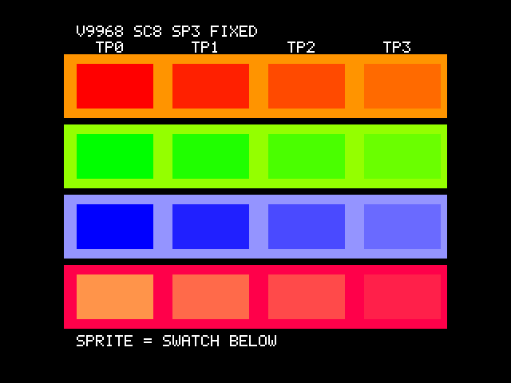

確認ポイント:

- [ ] TP0〜3 の各スプライトが、すぐ下の見本と同じ色で、つなぎ目が見えない（TP0 は固定16色そのもの、TP1〜3 は GRB332 背景との合成）
- [ ] 各スプライトにはパレットセット0〜15を指定しているが、色には影響しない
- [ ] スプライトの上と左右に見える背景の帯は元の色のまま

## P19 V9968 SC5 SP3 SCROLL SEAM

V9968: SCREEN 5 + スプライトモード3、SVNS=0、R#23=100。背景の周回の継ぎ目（VRAM ライン255→0、画面ライン156）をまたぐスプライトが途切れず、Y=256〜767 のスプライトは表示されない

期待画像（判定に使う）:

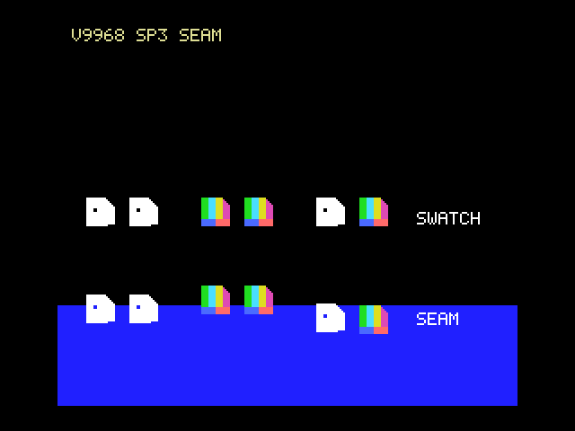

openMSX（Panasonic_FS-A1ST_V9968）のスクリーンショット（参考）:

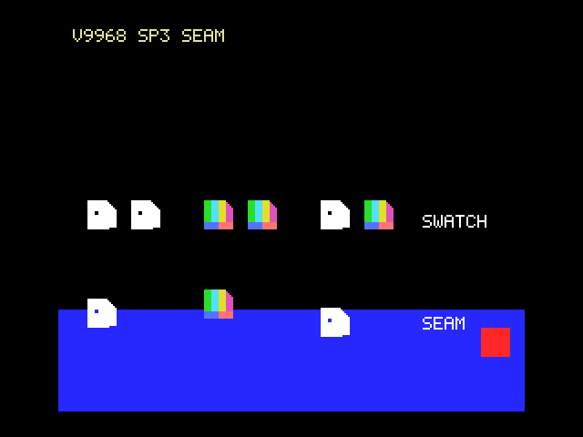

openMSX との違い: 継ぎ目をまたぐスプライトの一部が途切れたり表示されなかったりし（負の Y の2個は表示されない）、属性 Y=265 の赤いスプライトが表示されます。

確認ポイント:

- [ ] 画面ライン156（黒と青の境目＝VRAM ライン255→0 の継ぎ目）をまたぐ6個のスプライトが、継ぎ目で途切れず、画面上部の見本（SWATCH）と同じ形・同じ色
- [ ] 左から2個ずつ組の Y=250 と −6、Y=245 と −11 が、それぞれ同じ高さに表示される（−256〜−1 は Y+256 と同じ位置）
- [ ] 赤が見えない（属性 Y=265/386/642/767 のスプライトは表示されない）

## P20 SC5 INT EDGE COMPAT 192

走査線割込みの上端・下端チェック。192ライン、R#23依存（互換モード）。画面YとR#23を自動巡回し、64フレームの割込み回数が64でなければ赤を保持する。

動的なテストのため固定の参照画像はありません。上の説明とパネル表示で判定してください。

確認ポイント:

- [ ] 青と緑の境目が安定している。赤にならない（赤は取りこぼし／余分な割込みを検出した状態）
- [ ] パネルは画面Y・R#23・R#19を16進数で表示する。赤になったら巡回を停止し、その条件を保持する
- [ ] R#23は00/01/40/C8/FF、画面Yは0〜7・表示最終行±4・下の周辺部3か所を巡回する

## P21 SC5 INT EDGE COMPAT 212

走査線割込みの上端・下端チェック。212ライン、R#23依存（互換モード）。画面YとR#23を自動巡回し、64フレームの割込み回数が64でなければ赤を保持する。

動的なテストのため固定の参照画像はありません。上の説明とパネル表示で判定してください。

確認ポイント:

- [ ] 青と緑の境目が安定している。赤にならない（赤は取りこぼし／余分な割込みを検出した状態）
- [ ] パネルは画面Y・R#23・R#19を16進数で表示する。赤になったら巡回を停止し、その条件を保持する
- [ ] R#23は00/01/40/C8/FF、画面Yは0〜7・表示最終行±4・下の周辺部3か所を巡回する

## P22 V9968 SC5 INT EDGE ILNS 192

走査線割込みの上端・下端チェック。192ライン、R#23非依存（ILNS=1）。画面YとR#23を自動巡回し、64フレームの割込み回数が64でなければ赤を保持する。

動的なテストのため固定の参照画像はありません。上の説明とパネル表示で判定してください。

確認ポイント:

- [ ] 青と緑の境目が安定している。赤にならない（赤は取りこぼし／余分な割込みを検出した状態）
- [ ] パネルは画面Y・R#23・R#19を16進数で表示する。赤になったら巡回を停止し、その条件を保持する
- [ ] R#23は00/01/40/C8/FF、画面Yは0〜7・表示最終行±4・下の周辺部3か所を巡回する

## P23 V9968 SC5 INT EDGE ILNS 212

走査線割込みの上端・下端チェック。212ライン、R#23非依存（ILNS=1）。画面YとR#23を自動巡回し、64フレームの割込み回数が64でなければ赤を保持する。

動的なテストのため固定の参照画像はありません。上の説明とパネル表示で判定してください。

確認ポイント:

- [ ] 青と緑の境目が安定している。赤にならない（赤は取りこぼし／余分な割込みを検出した状態）
- [ ] パネルは画面Y・R#23・R#19を16進数で表示する。赤になったら巡回を停止し、その条件を保持する
- [ ] R#23は00/01/40/C8/FF、画面Yは0〜7・表示最終行±4・下の周辺部3か所を巡回する

## ビルド

```
build.bat
```

`VDPVIEW.COM`、`VDPINT.COM`、`VDPDIAG.COM` を生成します。VDPVIEW と VDPINT は同じ `VDPVIEW.ASM` から別々に組み立てます。

gen_vdpview.py が VDPVIEW.INC、VDPINT.INC と VDPVIEW.md（P14〜P16 の期待画像も）を生成します。

走査線割込みテストの回帰確認（Python の `z80` パッケージと同梱の `tool\zma.exe` が必要）:

```
python -m unittest -v test_vdpview_build test_vdpint_timing
```
